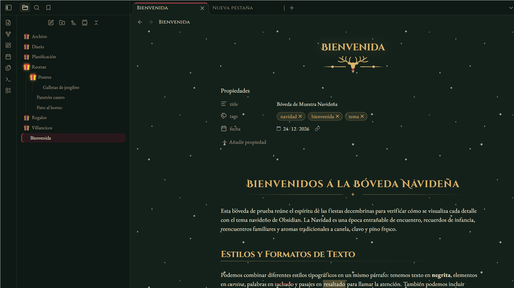
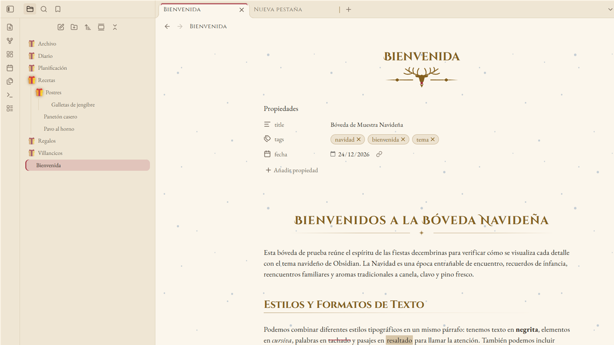

# Merry Christmas 🎄

A cozy Christmas theme for [Obsidian](https://obsidian.md): a pine forest by night with cranberry and gold,
and a Christmas-letter cream by day. Classic serif typography, golden ornaments, a reindeer under every
note title, gifts instead of folder arrows and gently falling snow.





## Features

- **Dark and light modes** — *Christmas Eve by the fire* (pine, cranberry, gold) and *Letter to Santa* (warm cream
  paper, ink brown). Text contrast meets WCAG AA in both.
- **Typography** — EB Garamond for reading, Cinzel for headings and Cinzel Decorative for the note title and H1,
  all embedded (no network requests). Optional playful *Mountains of Christmas* titles.
- **Ornaments** — a golden reindeer with a red nose under each note title, a gold rule with a star under H1 and on
  dividers, cranberry lozenges on H3, stars on checked tasks.
- **File explorer** — a 🎁 replaces the folder arrow (dimmed when closed, glowing when open), or a reindeer that
  stands up when the folder opens.
- **Falling snow** over your notes; it never catches clicks and hides itself when your system asks to reduce motion.
- **New tab** with the reindeer emblem.

## Settings

Install the [Style Settings](https://github.com/mgmeyers/obsidian-style-settings) plugin to tweak the theme:

| Option | Default |
|---|---|
| Disable falling snow / snow intensity | Snow on, 60 % |
| Folder toggle: gift 🎁, reindeer or native arrow | Gift |
| Emblem under the note title: reindeer, holly or none | Reindeer |
| Festive emojis on headings (🎄 H1, ⭐ H2, 🎁 H3) | Off |
| Disable heading and divider ornaments | Off |
| Playful Christmas font for titles | Off |
| Gold, cranberry and holly colors | Theme palette |

The accent color (buttons, links, selection) follows **Settings → Appearance → Accent color**.

## Installation

- **From Obsidian:** Settings → Appearance → Themes → Manage → search for *Merry Christmas* → Install and use.
- **Manually:** download `manifest.json` and `theme.css` from the
  [latest release](https://github.com/Mack-Yilman/obsidian-merry-christmas/releases/latest) into
  `<your vault>/.obsidian/themes/Merry Christmas/`, then pick the theme in Settings → Appearance.

## Development

`theme.css` is generated: edit `src/theme.src.css` and the SVGs in `src/ornaments/`, then run:

```bash
npm install
node build.mjs          # builds theme.css with fonts and ornaments embedded as base64
npm run lint            # Obsidian's official stylelint rules
node tools/contraste.mjs  # checks the palette contrast
```

## Español

Tema navideño para Obsidian, claro y oscuro: bosque de pino de noche con arándano y oro, y papel crema de carta a
Santa de día. Tipografía con serifa, adornos dorados, un reno bajo el título de cada nota, regalos 🎁 en lugar de
las flechas de las carpetas y nieve que cae suavemente. Las opciones se ajustan con el plugin Style Settings.

## Credits

Made by Mack Chirinos. The note layout is inspired by
[Nox Aeterna](https://github.com/white0dry/obsidian-nox-aeterna) by white0dry. Font licenses are listed in
[THIRD-PARTY-NOTICES.md](THIRD-PARTY-NOTICES.md).

## License

[MIT](LICENSE)
